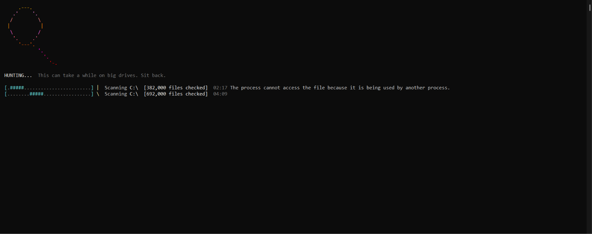

# BigFile-Hunter

**Find the files taking up the most space. Review them, then decide what to do.**

BigFile-Hunter is a lightweight Windows batch utility that scans selected drives, sorts files by size, and helps you inspect large files. It uses PowerShell (included with Windows) for scanning and file operations.



## Storage before and after

The screenshots you provided show the drive's available space before and after cleanup:

| 🔴 Before cleanup | 🔵 After cleanup |
| --- | --- |
| **2.46 GB free** | **199 GB free** |
| 475 GB total capacity | 475 GB total capacity |

That is approximately **196.54 GB more free space**. Your results will vary depending on which files you choose to remove.

## Features

- Sort files from largest to smallest or smallest to largest
- Display the top 10, 25, 50, 100, or a custom number of files
- Scan all ready drives or select specific drive letters
- Filter out files below a minimum size
- Open a selected file's location in File Explorer
- Move a selected file to the Recycle Bin after confirmation
- Save results as a CSV report on your Desktop

## Requirements

- Windows
- PowerShell, included with modern Windows versions

## Installation

### Download the ZIP

1. Visit the [BigFile-Hunter repository](https://github.com/Abujeje-sudo/BigFile-Hunter).
2. Select **Code** → **Download ZIP**.
3. Extract the ZIP to a folder.
4. Run `bfh.bat` from the extracted folder.

### Clone with Git

If Git is installed, open Command Prompt or PowerShell and run:

```bash
git clone https://github.com/Abujeje-sudo/BigFile-Hunter.git
cd BigFile-Hunter
```

Then run `bfh.bat`.

## How to use

1. Double-click `bfh.bat`, or run it from Command Prompt.
2. The script may ask whether to restart as Administrator. Administrator access can help scan protected folders, but is optional. Without it, some locations may be skipped.
3. Choose the sort order: **biggest first** or **smallest first**.
4. Choose how many results to show, or enter a custom count.
5. Choose which drives to scan. Press **Enter** to scan all ready drives, or enter letters such as `C D`.
6. Set the minimum file size in MB. Press **Enter** for the suggested default, or enter `0` to include all sizes.
7. Review the scan settings and confirm to start. A full drive scan can take some time.
8. Choose an action from the results menu:
   - **O** — Open the selected file's location
   - **D** — Move the selected file to the Recycle Bin
   - **S** — Save a CSV report to your Desktop
   - **N** — Start a new scan
   - **Q** — Quit

For **O** and **D**, enter the number shown beside the file. To confirm deletion, type `YES` when prompted. The script does not delete files without this confirmation.

## Safety

- Check the file path and make sure you recognize the file before deleting it. Avoid removing Windows system files or files needed by your applications.
- Deletion sends the selected file to the Recycle Bin. Recovery may not be possible if the Recycle Bin is bypassed or emptied.
- Some protected or inaccessible folders may be skipped, so scan results may be incomplete.
- Only run scripts from sources you trust.

## Why I made it

I created BigFile-Hunter when I was running low on storage and wanted a straightforward way to find the biggest files without searching through folders manually.
